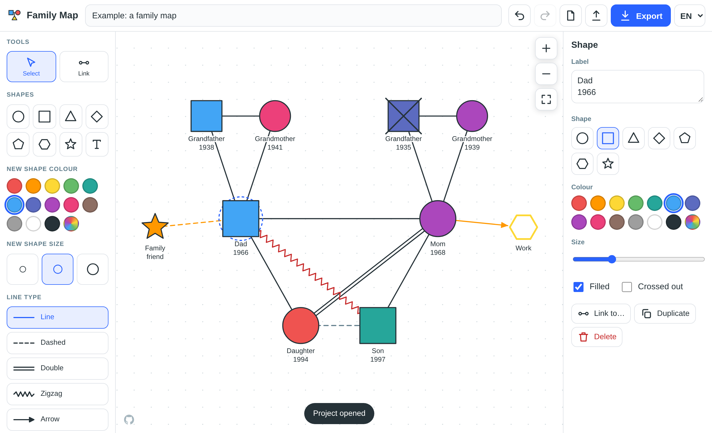
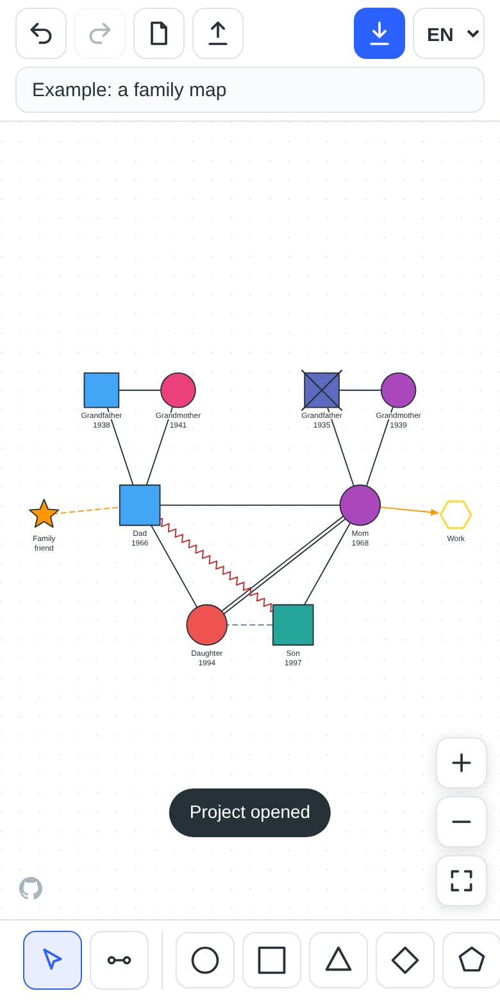
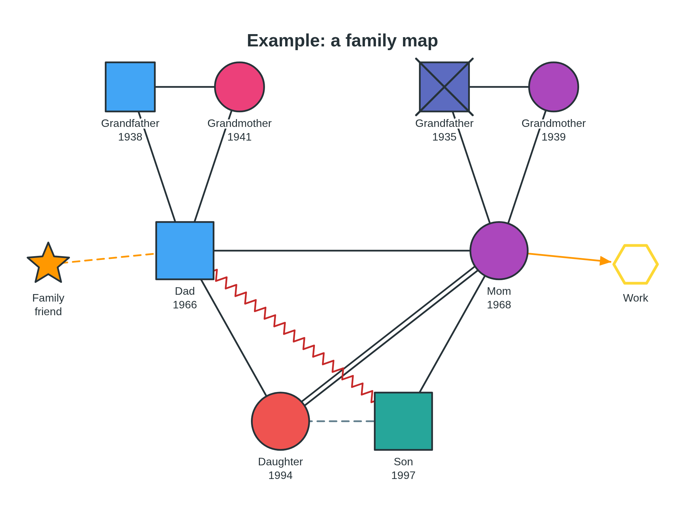

<div align="center">


# Family Map

**Draw a family on the spot. Talk it through. Take it home.**

A fast, private, dependency-free diagram builder for therapy, counselling and coaching sessions: place shapes of any colour and size, connect them with meaningful lines, and export the result for further discussion.

[**▶ Open the live app**](https://yinon-mitin.github.io/family-map/) &nbsp;·&nbsp; [Features](#-features) &nbsp;·&nbsp; [Quick start](#-quick-start) &nbsp;·&nbsp; [Run locally](#-run-locally)

[](https://yinon-mitin.github.io/family-map/)
[](LICENSE)
[](#-under-the-hood)
[](#-why-family-map)
[](#-made-for-the-room-not-just-the-desk)

<br>



</div>

<br>

## ✨ Why Family Map

A family diagram is most useful **while the conversation is happening**: the client names a person, you drop a shape, draw a line, change its colour. Family Map is built for exactly that moment.

- **Instant.** Open the page and start drawing. No account, no install, no setup.
- **Private by design.** Everything stays in the browser. Nothing is uploaded, nothing is tracked. Client data never leaves the device.
- **Your meaning, not ours.** Shapes and colours carry no fixed meaning, so you can follow genogram conventions, or invent your own language for a session.
- **Works anywhere.** The same app runs with a mouse and keyboard on a laptop, or with fingers on a tablet or phone.

> [!NOTE]
> The interface is in **Russian by default** and can be switched to **English** at any time (top-right corner). The choice is remembered.

## 🧩 Features

<table>
<tr>
<td width="50%" valign="top">

### Shapes
Circle, square, triangle, diamond, pentagon, hexagon, star and free **text labels**.

### Look & feel
13 preset colours plus a custom colour picker, a continuous **size slider**, filled or outline style, multi-line labels and a **"crossed out"** mark (for example for a deceased person).

### Relationships
Five line types, each with its own colour: **solid**, **dashed**, **double**, **zigzag** and **arrow** (reversible). Use them to express closeness, distance, conflict or direction, in whatever convention you prefer.

</td>
<td width="50%" valign="top">

### Canvas
Drag shapes, drag the background to pan, **scroll or pinch to zoom**, one-tap *fit to screen*. Labels keep a white halo so they stay readable where lines cross them.

### Editing
**Undo / redo** (100 steps), duplicate, delete, keyboard nudging, automatic saving in the browser.

### Export & share
**PNG**, **SVG**, **PDF** and **JSON** project files. An optional diagram title is printed on the exported picture and used as the file name. Re-open any JSON project later to continue.

</td>
</tr>
</table>

## 📱 Made for the room, not just the desk

<table>
<tr>
<td width="34%" valign="top" align="center">

<br><sub><b>On a phone or tablet</b><br>Touch dragging, pinch-to-zoom, a bottom toolbar within thumb reach and a properties sheet that slides in when something is selected.</sub>
</td>
<td width="66%" valign="top" align="center">

<br><sub><b>Export result</b> (PNG shown; SVG, PDF and JSON are one click away)<br>Clean white background, centred, with the title on top. Ready for a chat, an email, a slide or a printout.</sub>
</td>
</tr>
</table>

## 🚀 Quick start

1. **Open the app:** <https://yinon-mitin.github.io/family-map/>
2. **Add a shape:** tap any shape in the toolbar. Drag it where you want it and type a label in the properties panel.
3. **Connect people:** choose the **Link** tool and tap two shapes in turn. The line type comes from *Line type* in the toolbar.
   You can also select a shape and press **Link to…**.
4. **Refine:** tap a shape or a line to change its colour, size, shape or type. Double-click a shape to edit its label right away.
5. **Export:** press **Export** and pick PNG, SVG, PDF or JSON.

Want to see it first? Download [`examples/example-family.json`](examples/example-family.json) and open it with the **Open project** button (the upload arrow in the top bar).

<details>
<summary><b>Keyboard shortcuts</b></summary>

<br>

| Key | Action |
| --- | --- |
| `Delete` / `Backspace` | Delete the selected shape or link |
| `Ctrl/Cmd + Z` | Undo |
| `Ctrl/Cmd + Shift + Z`, `Ctrl/Cmd + Y` | Redo |
| `Ctrl/Cmd + D` | Duplicate the selected shape |
| Arrow keys (`Shift` = bigger step) | Nudge the selected shape |
| `Esc` | Leave link mode / clear the selection |
| Double-click a shape | Edit its label |
| Mouse wheel | Zoom |

</details>

## 🔒 Privacy

Family Map is a purely client-side app. The diagram is autosaved to your browser's `localStorage` so a refresh never loses work, and **nothing is ever sent to a server**: there are no analytics, no cookies and no third-party scripts. Exporting a file is the only way data leaves the page, and that is entirely your choice. Clearing the site data in your browser erases the autosave.

## 🛠 Run locally

No installation or build step. Any static file server works:

```sh
git clone https://github.com/yinon-mitin/family-map.git
cd family-map
python3 -m http.server 8000
# open http://localhost:8000
```

Opening `index.html` directly from disk works too.

## 🌐 Host your own copy

The repository is a plain static site, so GitHub Pages can serve it as-is:

1. Fork or push the repository to your account.
2. **Settings → Pages → Build and deployment:** source **Deploy from a branch**, branch `main`, folder `/ (root)`.
3. After a minute your copy is live at `https://<user>.github.io/<repository>/`.

## 🧱 Under the hood

Plain HTML, CSS and JavaScript. No framework, no bundler, no runtime dependencies. The canvas is SVG, input uses Pointer Events (one code path for mouse, touch and pen), and the PNG/PDF exporters are small hand-written routines (the PDF writer is ~40 lines).

```
index.html          page markup; UI text is filled in from js/i18n.js
css/style.css       responsive layout: three columns on desktop, bottom toolbar on phones
js/i18n.js          Russian and English translations
js/app.js           editor: rendering, interaction, history, export and import
examples/           a sample project to open in the app
docs/               screenshots used in this README
favicon.svg
```

<details>
<summary><b>Project file format</b></summary>

<br>

Exported JSON has the form:

```json
{ "app": "family-map", "version": 1, "doc": { "title": "…", "nodes": [], "links": [] } }
```

Nodes carry `id, shape, x, y, size, color, filled, dead, label`; links carry `id, from, to, style, color`. Imported files are validated and normalised before use, so a malformed file cannot break the editor.

</details>

<details>
<summary><b>Adding a language</b></summary>

<br>

1. Add a new object to `window.I18N` in `js/i18n.js` with the same keys as `en`.
2. Add an `<option>` to the `#lang` select in `index.html`.
3. Extend the language check in `setLang()` in `js/app.js`.

</details>

**Browser support:** current Chrome, Edge, Firefox and Safari on desktop and mobile (needs SVG, Pointer Events and the `<dialog>` element).

## 📄 License

Released under the [MIT License](LICENSE). Free to use, copy, modify and share.

<div align="center">
<br>
<sub>Built for people who help people talk about their families.</sub>
</div>
